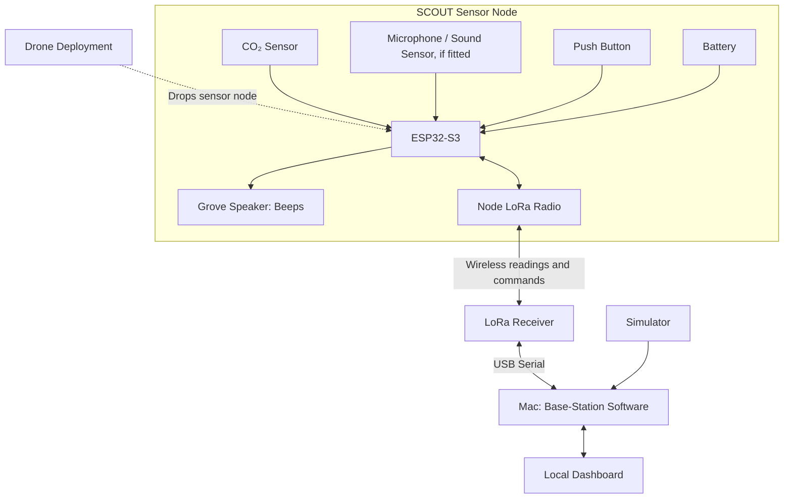

## Team 24 · SCOUT — Search and Communication Observation Unit
Deploy sensors. Monitor conditions. Send a signal back.

Names: Sai Pulavarthy, Kiran BK, Harry Zhu

An offline search-and-rescue prototype developed for the Code Metal Forge Hackathon · November 6–8, 2026.
Overview
After a structural collapse, responders need information from areas that can be difficult to reach. Our project explores small sensor nodes that report environmental readings and interaction events to a local base station, helping responders identify areas for further investigation.

The prototype combines ESP32-based firmware, CO₂ sensing, button interaction, audio event logic, and speaker signals with a local dashboard. LoRa provides the intended wireless link between deployed nodes and the base station.

This is a hackathon prototype, not a validated rescue or life-safety instrument. CO₂ and sound events are evidence to investigate; neither confirms a survivor, and their absence does not rule one out.

## Prototype Features

| Area | Functionality |
|---|---|
| CO₂ monitoring | Sensor readings, sudden-rise detection, hold-time rules, and DEMO/FIELD profiles |
| Button interaction | Two-press confirmation, arming delay, and stuck-button protection |
| Sound events | Separate thresholds and durations for knock and voice-like activity when a microphone or sound sensor is connected |
| Speaker output | Non-blocking beep patterns, tone generation, and siren test effects |
| Dashboard | Live node cards, CO₂ chart, command controls, and event timeline |
| Base station | FastAPI service, serial and simulator inputs, SQLite logging, and WebSocket updates |
| Protocol | Message parsing, command validation, and unit tests |

## System Block Diagram


```

Drone deployment is the intended operating method. Audio detection requires a connected microphone or sound sensor. The simulator provides test data independently of physical hardware.

## Hardware

| Component | Role |
|---|---|
| Adafruit Feather ESP32-S3 | Reads inputs, evaluates events, and handles node commands |
| CO₂ sensor | Measures CO₂ concentration in the air reaching the sensor |
| Compatible LoRa radios and antennas | Carry sensor messages and return commands |
| Grove speaker | Produces audible beep signals |
| Push button | Supports deliberate user interaction |
| Microphone / sound sensor, if fitted | Supplies audio input for event detection |
| Breadboard, jumper wires, and power source | Support prototype assembly and testing |


Audio input and output are separate: the Grove speaker produces sound. Listening requires a microphone or sound sensor. The current demo uses Grove speaker beeps. The intended Adafruit speaker was unavailable for the hackathon, so prerecorded speech playback is a future integration and is not demonstrated.

Exact sensor models, voltage requirements, and GPIO assignments must match the firmware configuration. Check pin assignments before combining individually tested components.

## How It Works

1. Collect: the node reads CO₂ and any connected interaction or audio inputs.
2. Assess: firmware applies configured timing and decision rules.
3. Report: readings and events are forwarded to the base station.
4. Display: the dashboard updates node information, charts, and the timeline.
5. Respond: an operator sends a supported command, such as triggering a beep or resetting node state.
CO₂ concentration is reported in ppm. Interpretation depends on airflow, space size, sensor placement, and changes over time. DEMO settings are for demonstrating behavior; a FIELD profile name does not establish field validation.

## Demonstration Flow

1. Start the base station and open the local dashboard.
2. Show the selected data source: simulator or physical hardware.
3. Display incoming node readings and the CO₂ trend.
4. Exercise a configured sensor event or button-confirmation sequence.
5. Trigger a beep from the dashboard and verify the node responds.
6. Demonstrate relevant guard conditions, including stuck-button handling and speaker-related microphone muting when audio hardware is fitted.
Repository Guide
Location	Purpose
base/	Base-station software and dashboard
firmware/	Node-side firmware resources and configuration
tests/	Test resources and results documentation
LICENSE	Apache License 2.0


## Testing and Validation

For each physical test, record the hardware model, firmware configuration, environment, expected behavior, observed result, and limitations. Keep simulated results separate from physical measurements.
Limitations and Future Work
- CO₂ is supporting evidence: ventilation, other CO₂ sources, and placement affect readings.
- Sound thresholds are not verified human identification: background noise and speaker feedback require testing.
- Radio coverage is environment-dependent: building materials and rubble can impair communication.
- A direct LoRa link is not a mesh: relaying needs its own implementation and multi-node validation.
- Location requires a source: use assigned placement locations unless a GPS/GNSS module is integrated. Node coordinates do not identify a person's exact position.
- Remote deployment is a project goal: drone or ground-robot placement requires separate payload, enclosure, and deployment testing.
Automatic Prerecorded Messages
A planned integration is to play a locally stored spoken message automatically after the node is dropped and deployment is confirmed. For example: “This is a rescue sensor. Rescue personnel are nearby.” The message would introduce the node to someone nearby without requiring them to understand a custom beep pattern.

The intended Adafruit speaker was unavailable for this hackathon, so this feature is not part of the demo. The current demo uses the Grove speaker for beeps. Future implementation will require suitable speech-playback hardware and a tested deployment trigger to avoid playing messages prematurely.

Other future work includes validated relay operation, GPS/GNSS integration, ATAK integration, stronger audio-event assessment, battery/runtime testing, and deployment trials.
Team

Built by Team 24 for the Code Metal Forge Hackathon 2026.
License
This repository is licensed under the Apache License 2.0. See LICENSE.
